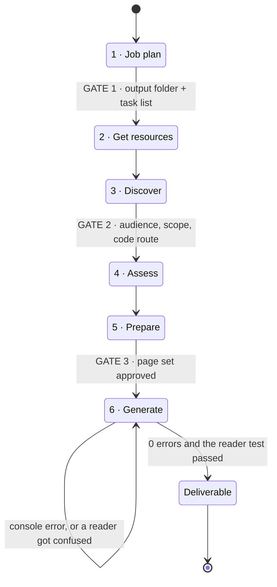
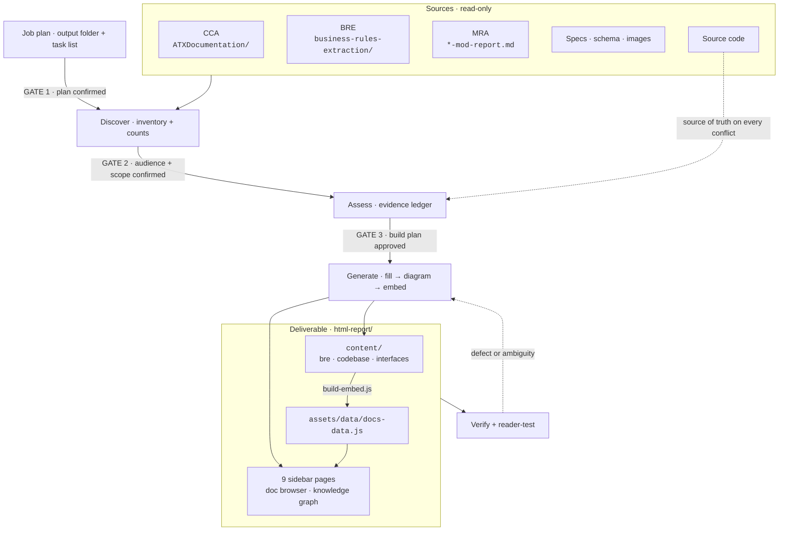

# make-html

Turn AWS Transform (ATX) assessment output into a polished, **bilingual (Thai / English)** static HTML documentation site that a customer can open straight in a browser — no server, no build step.

The site is a deep-dive portal, not a summary deck: executive dashboard, per-domain business rules, modernization scoring, roadmap, an interactive knowledge graph, and a full document browser over every source report — all driven by **Mermaid** diagrams and the real report data.

---

## What it produces

| Page | Contents |
|---|---|
| `index.html` | Executive dashboard — KPIs, readiness gauge, domain grid, top gaps |
| `codebase.html` | Codebase analysis narrative |
| `domains.html` | Domain summary, context map, extraction order, coupling hotspots, integrations, data topology |
| `domain-detail.html` | Per-domain deep dive (overview, features, rules, workflows, validations, integrations, diagrams, target service spec) |
| `modernization.html` | Category scores, classification, per-question findings, AWS pathways, target architecture |
| `roadmap.html` | Phased roadmap + technical-debt register |
| `reference.html` | Document browser over the whole corpus (its own collapsible `<details>` tree) |
| `knowledge-graph.html` | Interactive D3 graph of screens, modules, endpoints, tables and externals |
| `methodology.html` | How the assessment was produced, and **what was actually analyzed** |

Shared chrome across the nine sidebar pages: collapsible nav that remembers its state, language toggle, Tailwind styling.

---

## Inputs

| Source | Typical location | Feeds |
|---|---|---|
| **CCA** — comprehensive-codebase-analysis | `ATXDocumentation/` | `content/codebase/` + codebase pages |
| **BRE** — business-rules-extraction | `business-rules-extraction/` | `content/bre/` + domains, deep-dives, knowledge graph |
| **MRA** — modernization-readiness-analysis | `services/<app>/modernization-readiness-analysis/*-mod-report.md` | scores, findings, pathways, roadmap |
| **Source code** *(optional)* | the repo itself | deep-dive analysis + knowledge graph |

Report paths vary between projects — the skill discovers them rather than assuming.

### Supporting inputs

Projects rarely hand over only ATX Markdown, so these are first-class too:

| Input | Handling |
|---|---|
| **OpenAPI / Swagger**, **Postman collection** | `scripts/normalize_interfaces.py` converts them to cited Markdown in `content/interfaces/` |
| **Word / PDF** interface documents | extracted via the `docx` / `pdf` companion skills, then saved as Markdown |
| **Excel** contracts | converted to Markdown tables |
| **Database schema DDL** | read directly — drives the ER diagram and data-model sections |
| **Database data export** | analysis only: row counts, empty tables, and the real value domain of status/flag columns. Never copied into the site |
| **Images** — architecture slides, topology diagrams, screenshots | read to guide the analysis; the ones the site displays are copied to `assets/img/` and referenced root-relatively |

The normalizer cites every section with a JSON pointer, redacts credential-shaped values and internal IPs, and reduces request/response bodies to their **shape** — keys and value types, never values. Exported collections routinely carry live tokens and real records, and a documentation site is a file people forward by email.

That is also why a data export stays outside `content/`: everything there is embedded into `docs-data.js` and ships with the site, so record-level data would be effectively published. Sample rows are excluded **even when masked** — a name, a birth date and a room number together re-identify a person, and a value domain already tells the reader what an example row would.

A spec is a claim, not a behaviour. Specs drift because nothing breaks when they go stale, so the code still wins — and "the spec lists 9 endpoints, 6 are registered" is itself a finding worth publishing. An image is weaker still: undated, unversioned, hand-drawn. Treat what you read off a diagram as a lead to confirm in code, never as a finding, and prefer a Mermaid diagram over a pasted picture whenever the content allows.

Images are also the one place automated checks cannot help: no grep reads a PNG, so every image has to be opened and looked at before it ships. Screenshots of live systems carry patient data, and architecture slides carry internal hostnames and IPs.

---

## How to use it

Just ask. The skill triggers on requests like:

- "สร้าง html จาก ATX reports ที่อยู่ใน repo นี้"
- "turn the CCA and BRE output into a browsable bilingual site with mermaid diagrams"
- "use the html-template to build the assessment portal"
- "the BRE now has 7 domains instead of 5 — refresh the site"

It then runs a six-step engagement, stopping for your confirmation at steps 1, 3 and 5:

1. **Job plan** — output folder (defaults to `html-report/`), task list → **you confirm**
2. **Get resources** — locate the scaffold, the reports, and the source code
3. **Discover resources** — inventory repos + reports with counts → **you confirm audience + scope**
4. **Assess** — read the reports; optionally reverse-engineer and deep-dive the code
5. **Prepare** — confirm the page set and adaptations → **you approve** → scaffold copied, content mirrored
6. **Generate** — fill data, author diagrams, embed content, verify in a browser, reader-test

Step 1 is deliberately a handshake, not an interview: three things (activate `doc-coauthoring`, name the
output folder, create the task list), then it stops. Audience and scope wait for step 3, because you can
only promise depth once you know what material actually exists. Nobody is asked which language to work
in — the site ships bilingual regardless, and whichever language you wrote in is the answer.

If you'd rather skip the interaction, say "just generate it": gate 1 passes on the default folder
`html-report/`, gates 2 and 3 become a stated decision rather than a stop, and the reader-test still
runs at the end — that is what catches blind spots, so it is the one thing "just generate it" does not
switch off.

### Workflow at a glance

Six steps, three gates, one loop. A **GATE** on a transition means the run stops there and waits
for you; everything else flows on its own.



The self-loop on step 6 is where most of the work actually happens: fill, verify, fix, verify again.
The full picture — gate reject paths, the substates inside Assess and Generate, and where the
reader test sits — is below.

### Workflow state — in detail

The three diamonds are the human gates, and they are not the same kind of stop.

Gates 2 and 3 guard work that is expensive and awkward to unwind — a full code-assessment pass, and a
scaffold copy followed by a generate run. Skipping them is how you end up assessing the wrong
repository or building the wrong page set.

Gate 1 guards nothing yet: no report has been read and no file written, and either later gate would
catch a wrong output folder long before it reached the deliverable. It is there so the run starts from a
stated frame instead of an assumed one — worth one exchange, and it passes in one line. It also passes
automatically when the answer is already on the table, because stopping for a confirmation you already
have is how people learn to click through the ones that matter.

```mermaid
stateDiagram-v2
    direction TB
    [*] --> JobPlan

    state "1 · Job plan" as JobPlan
    state Gate1 <<choice>>
    state "2 · Get resources" as GetResources
    state "3 · Discover resources" as Discover
    state Gate2 <<choice>>
    state "4 · Assess" as Assess
    state "5 · Prepare" as Prepare
    state Gate3 <<choice>>
    state "6 · Generate" as Generate
    state "Verify — technical" as Verify
    state "Reader test" as ReaderTest
    state "Deliverable" as Done

    JobPlan --> Gate1 : doc-coauthoring active · output folder + task list proposed

    Gate1 --> JobPlan : GATE 1 · not confirmed — change the output folder
    Gate1 --> GetResources : GATE 1 · confirmed

    GetResources --> Discover : scaffold + CCA/BRE/MRA + supporting inputs in hand
    Discover --> Gate2 : inventory with counts presented

    Gate2 --> Discover : GATE 2 · not confirmed — refine scope or supply a missing report
    Gate2 --> Assess : GATE 2 · confirmed — audience, scope + code-assessment choice made

    state Assess {
        direction TB
        state "4a · Reverse-engineer code" as RevEng
        state "4a′ · Deep-dive + knowledge graph" as DeepDive
        state "4b · Read ATX reports" as ReadATX
        state "4c · Reconcile sources" as Reconcile
        [*] --> RevEng : code assessment chosen
        [*] --> ReadATX : ATX-only
        RevEng --> DeepDive
        DeepDive --> ReadATX
        ReadATX --> Reconcile
        Reconcile --> [*]
    }

    Assess --> Prepare : evidence ledger + counts established
    Prepare --> Gate3 : page set + adaptations proposed

    Gate3 --> Prepare : GATE 3 · not approved — adjust pages, adapt template sections
    Gate3 --> Generate : GATE 3 · approved — copy scaffold, mirror content, normalize, redact

    state Generate {
        direction TB
        state "Fill page data" as Fill
        state "Author Mermaid diagrams" as Diagrams
        state "node build-embed.js" as Embed
        [*] --> Fill
        Fill --> Diagrams
        Diagrams --> Embed
        Embed --> [*]
    }

    Generate --> Verify
    Verify --> Generate : console errors / Mermaid syntax error / empty section
    Verify --> ReaderTest : 0 errors, all data rendered, menu toggles
    ReaderTest --> Generate : fresh reader confused or misled
    ReaderTest --> Done : reader answers correctly
    Done --> [*]

    note right of JobPlan
        Three things only: activate
        doc-coauthoring, name the output
        folder, create the task list.
        Working language is never asked —
        it is whatever the user wrote in.
        Audience and scope wait for GATE 2.
    end note

    note right of Discover
        Inventory is reported with counts —
        domains, tables, features, rules, findings.
        Those same counts are checked against
        the finished site at Verify.
    end note

    note right of Verify
        Both loops run until clean.
        Verify catches what is broken;
        Reader test catches what is
        merely unclear — a page can
        render perfectly and still
        mislead.
    end note
```



And the same run seen as artifacts rather than states — what is read, what is written, and the
one dependency that decides every disagreement:



---

## Guardrails

The site is used to plan real implementation work, so a fabricated detail costs more than a missing one — it destroys trust in everything else on the page. The skill therefore holds to:

- **Source code is the source of truth.** Reports, READMEs and comments are hypotheses to verify against code. Where they disagree, the code wins and the conflict gets reported.
- **No inventing or guessing** — no endpoint, table, column, threshold or dependency appears unless it exists in the source.
- **Claims cite `file:line`.** If a line can't be pointed at, the fact isn't established yet.
- **"Not determined" is a valid answer** — preferred over a plausible guess, because it tells the reader where to look next.
- **Inferences are labelled** `INFERRED` with their reasoning and their gap.
- **Diagrams follow evidence.** An arrow with no call site behind it is fabrication in visual form.
- **Coverage is reported honestly** — what was read line by line, what was skimmed, what was not analyzed.

---

## Companion skills

| Skill | Role | Required? |
|---|---|---|
| `doc-coauthoring` | Conducts the engagement — context gathering, section-by-section drafting, reader testing | Recommended |
| `aidlc-reverse-engineering` | Accelerates code assessment into 9 structured codekb artifacts | Optional — separate install |
| `pdf` / `docx` | Extract interface specs delivered as PDF or Word | Only if you have such documents |

Code assessment has two routes, and **only one of them depends on anything being installed**:

- **Route A — read the code** using `references/deep-analysis.md`. Always available, reaches line-level evidence, and it is what the deep-dive sections actually need. This is the default.
- **Route B — reuse or generate a codekb.** Faster, but it needs the `aidlc-reverse-engineering` skill (a *separate* install, usually not present alongside this one) plus AI-DLC **v2** prerequisites: `bun`, `.kiro/tools/aidlc-orchestrate.ts`, `.kiro/aidlc-common/`. An existing codekb on disk can be reused without the skill.

The skill checks all of that **before** putting Route B on the gate-2 menu, because offering an option it cannot perform is worse than not offering it. When Route B is unavailable it says which piece is missing and proceeds with Route A — it never pretends the analysis happened, and it does not offer installing the harness as a fix for a missing skill.

---

## Layout

```
make-html/
├── SKILL.md                        the workflow and guardrails
├── README.md                       this file
├── scripts/
│   ├── normalize_interfaces.py     OpenAPI + Postman → cited, redacted Markdown
│   └── vendor_web_assets.py        re-download the vendored fonts + stylesheets (--check verifies)
├── references/
│   ├── template-architecture.md    scaffold internals + per-page data contracts
│   ├── source-mapping.md           ATX field → page/variable, + codekb precedence rules
│   ├── deep-analysis.md            evidence discipline, 6-stage pipeline, knowledge graph
│   └── authoring-guide.md          bilingual conventions, Mermaid catalog, verification
└── assets/
    ├── html-template/              the reusable scaffold — copy this
    │   └── assets/
    │       ├── css/fonts.css       VENDORED @font-face → ../fonts/ (no Google Fonts call)
    │       ├── css/highlight-github-dark.min.css   VENDORED hljs theme
    │       └── fonts/*.woff2       VENDORED Inter / Noto Sans Thai / JetBrains Mono + SHA256SUMS
    └── html-sample/                a complete worked example (dental clinic, 5 domains)
```

**Nothing is fetched at open time — the site renders fully offline.** Fonts, the highlight.js
theme, and the five JavaScript libraries (Tailwind, Mermaid, marked, highlight.js, D3) all
ship inside the deliverable. This matters because a network dependency in a file that gets
emailed onward fails *silently*: a blocked font renders the wrong typeface (Thai worst), and a
blocked Tailwind renders the right type over a collapsed layout — the page looks plausible and
is wrong. The fonts and the minified libraries are the bundle's only unreviewable files, so
each is pinned by a `SHA256SUMS` manifest and verified on every compliance run. Regenerate
everything with `python3 scripts/vendor_web_assets.py`; `--check` fails if any page drifted
back to a CDN.

The cost is bundle size: the vendored libraries are ~4 MB per site tree, most of it Mermaid,
which is why the skill is ~13 MB rather than ~5 MB. That weight buys a deliverable that opens
correctly on an air-gapped laptop, which for a customer assessment is the right trade. Tailwind
is vendored as its CDN *runtime* (it still generates CSS in the browser from the utility
classes and the inline `tailwind.config`), so the authoring model is unchanged — you write
utility classes exactly as before, they just no longer need the network.

`html-template/content/` ships **empty** on purpose, so nothing from a previous engagement can leak into a customer deliverable.

---

## Verification status

Reviewed before release:

| Check | Result |
|---|---|
| skill-creator validator | valid |
| Compliance suite — structure, assets, security, claims, executability, identity, README, step-1 gate | **259 / 259** |
| Mutation test — each guarantee broken on a scratch copy to prove the check can fail | **36 / 36 caught, 0 stale** |
| Bundle hygiene — binaries, nested VCS checkouts, OS/editor droppings | 0 (`.DS_Store` found and removed in review; now a check) |
| Customer identity, internal addressing or credential material in the bundled assets | **0** — denylist scan, template and sample |
| Normalizer redaction, run against a spec seeded with 6 credentials + PII values | 0 survived |
| Bundled binary assets, nested VCS checkouts, hardcoded stack labels in the scaffold | 0 |
| Trigger accuracy (16 queries, blind-judged) | **100%** — 0 false fires, 0 missed |
| Capability eval — populate a page from the MRA report | **11 / 11** (baseline 10 / 11) |
| Capability eval — build from identity-seeded sources, safe to forward | **15 / 15** (baseline 11 / 15) |
| Sample site rendered in a browser — 11 pages | 0 console errors, 30 / 30 Mermaid diagrams to SVG, 0 identity leaks |

The two capability evals are graded by file inspection, not self-report, and the baseline is the
pre-change version of this same skill — so the delta measures what the redaction guardrail bought.
It landed where you would hope: the baseline redacted IPs, hostnames and secret values on its own,
but shipped the organisation name in a footer and kept three schema columns whose prefix was the
customer's acronym, having reasoned that "code identifiers" were safe. Naming that case explicitly
is most of what the guardrail does.

Known limits, stated plainly:

- **The three human gates are reviewed, not tested.** Both eval prompts disabled them, so no measured run has an agent actually performing gate 1, 2 or 3. Their documentation is held by 20 compliance checks that mutation-testing proves will fail if the text drifts — but a check holding the prose and an agent behaving correctly at the gate are two different claims, and only the first is evidenced.
- The skill has not been run end-to-end on a full real project other than the bundled example, so its ergonomics on an unfamiliar report layout are still lightly tested. The seeded-fixture eval exercises the redaction path but is deliberately small.
- Capability evals ran **n=1 per configuration**. The grading is deterministic, so there is no measurement noise in the numbers, but a single run cannot show how much the agent's choices vary between reruns.
- **Time and token cost were not measured** for those runs. The redaction pass and the reader test both add work; how much is unquantified here.
- Filling the full page set is authoring work, not a script — expect to iterate on prose and diagrams.
- Images remain the one input class no automated check covers. The skill tells you to open each one; nothing enforces it.
